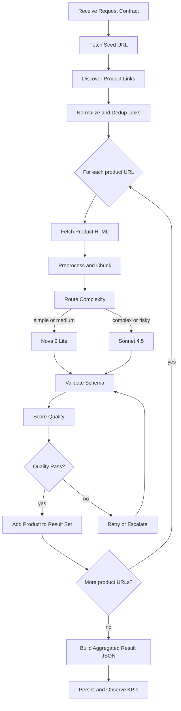
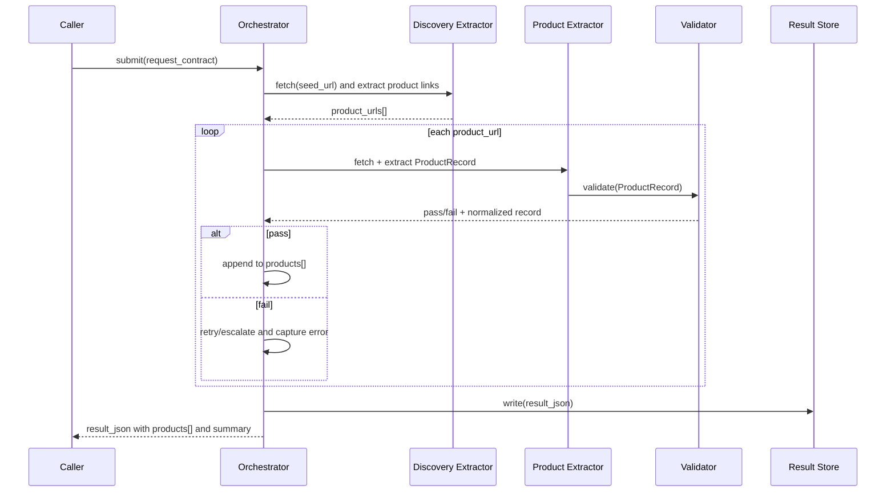

# Product Scraper Agent Design (Pre-Implementation)

## 1. Purpose
Design a production-ready product scraper agent that can extract structured product data from e-commerce HTML pages with high coverage, controlled cost, and predictable reliability.

This design is aligned with lessons from `AgentCore_CoE_pv.pdf`:
- Volume + speed + cost are the main constraints.
- Agent executions can hit runtime timeout constraints.
- Large HTML creates context overflow risk.
- Parallel runs must avoid context carryover contamination.
- Model tiering and semantic caching are required for cost control.

## 2. Goals and Non-Goals

### Goals
- Extract normalized product records from heterogeneous HTML pages.
- Maximize product coverage while keeping schema-valid output.
- Keep cost per product predictable through routing and caching.
- Support horizontal scaling with explicit rate-limit controls.
- Provide full observability and quality auditability.

### Non-Goals
- Real-time browser automation for anti-bot bypass in v1.
- Full autonomous purchasing/comparison behavior.
- Human UI workflows (approval console can be v2).

## 3. Key Requirements

### Functional
- Input: contract JSON with source URL and crawl options.
- Discover product links from listing/category/search pages.
- Loop over discovered product links and extract one `ProductRecord` per page.
- Output: one aggregated schema-valid result JSON containing all extracted products.
- Deduplicate equivalent products across formatting variants.
- Enrich missing fields when confidence is sufficient.
- Validate extraction result against strict schema contracts.

### Non-Functional
- Throughput: batch processing with controlled concurrency.
- Reliability: retry strategy for transient failures.
- Cost: token-aware chunking and selective model escalation.
- Latency: bounded end-to-end execution per batch.
- Traceability: per-item model, token, cost, and quality trace.

## 4. Proposed High-Level Architecture



## 4.1 Reference Execution Sequence (Job Collector Pattern)



## 5. Core Components

### 5.1 Ingestion Layer
- Accepts URL, HTML snapshot, crawl metadata.
- Stores immutable raw payload for replay/debug.
- Generates `request_id` and `product_batch_id`.

### 5.2 HTML Preprocessor
- Remove scripts/styles/navigation noise.
- Preserve high-signal product zones (title, price, specs, availability, images).
- Produce both:
  - `compact_html` for extraction.
  - `forensic_html_ref` pointer for diagnostics.

### 5.3 Chunking and Recursive Summarization
- Split long HTML into semantically meaningful blocks.
- Keep critical fields at the start of prompt context.
- Apply recursive summarization only when token budget is exceeded.
- Emit token budget telemetry per stage.

### 5.4 Complexity Router
Routes each item before extraction:
- Low complexity: static page, known template, clear product blocks.
- Medium complexity: noisy layout, partial schema hints.
- High complexity: dynamic fragments, inconsistent variants, sparse labels.

Routing policy:
- Default model: Nova 2 Lite (coverage/cost balance).
- Validation/escalation model: Sonnet 4.5 when quality gate fails.

### 5.5 Extraction Agent
- Stateless per item (no cross-item conversation history).
- Prompt includes:
  - strict output JSON schema,
  - extraction rules and normalization rules,
  - prohibited hallucination instructions,
  - missing-field behavior (`null`, not fabricated).

### 5.6 Schema Validator and Contracts
- Validate against versioned schema (`ProductRecord v1`).
- Reject invalid enum/type/format values.
- Return machine-readable error reasons.

### 5.7 Quality Gate
Compute score from:
- required field completeness,
- field consistency (price/currency/availability),
- confidence signals,
- schema warning count.

If below threshold:
- re-run with upgraded prompt,
- optionally escalate to Sonnet 4.5,
- cap retries to avoid runaway cost.

### 5.8 Semantic Dedup + Cache
- Normalize textual signatures and product identifiers.
- Cache key candidates:
  - canonical URL hash,
  - normalized title + brand + attributes fingerprint.
- Use semantic similarity threshold to merge equivalents.
- Reuse prior validated extraction for identical/near-identical pages.

### 5.9 Persistence
Recommended storage split:
- Raw: object storage (HTML snapshots, prompts, model responses).
- Curated: relational or document DB for `ProductRecord`.
- Search/index: optional for retrieval and analytics.

### 5.10 Observability
Track:
- tokens in/out by model,
- cost per product and per batch,
- coverage ratio,
- schema error rate,
- cache hit ratio,
- escalation rate,
- latency percentile,
- retries and final failure categories.

## 6. Orchestration Pattern

Use a workflow orchestrator with bounded fan-out/fan-in.
- Parent workflow receives batch.
- Child execution per product page.
- Concurrency guardrails to respect runtime quotas.
- Dead-letter queue for non-recoverable failures.

Rate-limit guidance from source deck:
- Runtime invocation constraints must be enforced centrally.
- Start with conservative parallelism and raise only after metric validation.

Execution phases:
- Phase 1 Discovery: seed URL fetch + link extraction + URL canonicalization.
- Phase 2 Detail Loop: iterate through product URLs with bounded concurrency.
- Phase 3 Aggregation: consolidate products, dedup final set, compute summary.
- Phase 4 Output: return single result envelope JSON.

## 7. Data Contracts

### 7.1 Input Contract
```json
{
  "request_id": "uuid",
  "tenant_id": "string",
  "source_url": "https://example.com/category/laptops",
  "crawl_ts": "2026-08-21T00:00:00Z",
  "max_products": 200,
  "max_depth": 2,
  "allowed_domains": ["example.com"],
  "use_browser_fallback": false,
  "include_raw_html": false,
  "source_meta": {
    "country": "US",
    "currency_hint": "USD"
  }
}
```

### 7.2 Output Contract (ProductRecord v1)
```json
{
  "product_id": "stable-fingerprint",
  "source_url": "https://...",
  "title": "string",
  "brand": "string|null",
  "description": "string|null",
  "category": "string|null",
  "price": {
    "amount": 0.0,
    "currency": "USD"
  },
  "availability": "in_stock|out_of_stock|preorder|unknown",
  "images": ["https://..."],
  "attributes": {
    "color": "string|null",
    "size": "string|null"
  },
  "variants": [
    {
      "sku": "string|null",
      "price": { "amount": 0.0, "currency": "USD" }
    }
  ],
  "confidence": 0.0,
  "extraction_meta": {
    "model": "string",
    "token_in": 0,
    "token_out": 0,
    "cache_hit": false,
    "schema_version": "v1"
  }
}
```

### 7.3 Aggregated Result Contract
```json
{
  "request_id": "uuid",
  "source_url": "https://example.com/category/laptops",
  "started_at": "2026-08-21T00:00:00Z",
  "finished_at": "2026-08-21T00:02:11Z",
  "summary": {
    "discovered_links": 148,
    "processed_links": 120,
    "successful_products": 116,
    "failed_products": 4,
    "duplicates_removed": 9
  },
  "products": [
    {
      "product_id": "stable-fingerprint",
      "source_url": "https://example.com/product/abc",
      "title": "string",
      "brand": "string|null",
      "price": { "amount": 0.0, "currency": "USD" },
      "availability": "in_stock|out_of_stock|preorder|unknown",
      "confidence": 0.0,
      "extraction_meta": {
        "model": "string",
        "token_in": 0,
        "token_out": 0,
        "cache_hit": false,
        "schema_version": "v1"
      }
    }
  ],
  "errors": [
    {
      "url": "https://example.com/product/xyz",
      "stage": "extract|validate|fetch",
      "reason": "string",
      "retry_count": 1
    }
  ]
}
```

## 8. Prompt and Tooling Strategy

### Prompt layers
- System: extraction role + no fabrication + schema-first behavior.
- Developer: normalization rules and deterministic priorities.
- User payload: chunked HTML + source metadata.

### Tooling
- HTML cleaner tool.
- Currency/units normalization tool.
- Schema validation tool (hard fail on invalid JSON contract).
- Optional browser tool only for missing-render fallback (v2).

## 9. Failure Modes and Mitigations

- Timeout risk:
  - Async execution mode and chunk-level checkpoints.
- Context overflow:
  - Chunking, field-first ordering, recursive summarization.
- Cross-item contamination:
  - Strict stateless per-item agent sessions.
- Hallucinated fields:
  - OpenAPI/JSON schema contracts + null-for-missing policy.
- Cost spikes:
  - Cache-first lookup, routing thresholds, retry caps.
- Provider throttling:
  - Backoff + queue + centralized concurrency limiter.

## 10. Security and Governance
- PII-safe logging with redaction.
- Signed access to raw payload storage.
- Tenant-level isolation keys.
- Prompt/response retention policy with TTL.
- Versioned prompts and model policy controls.

## 11. Rollout Plan

### Phase 0: Baseline
- Build extraction pipeline with Nova 2 Lite only.
- Measure coverage, schema pass rate, and cost baseline.

### Phase 1: Quality Layer
- Add quality gate + Sonnet 4.5 escalation path.
- Compare delta quality vs delta cost.

### Phase 2: Cache and Dedup
- Add semantic cache and duplicate merge logic.
- Target substantial reduction in repeated model calls.

### Phase 3: Scale Hardening
- Tune concurrency, retries, alerts, and failure routing.
- Validate SLA at target throughput.

## 12. KPI Targets (Initial)
- Coverage >= 95%
- Schema-valid outputs >= 99%
- Cost per extracted product within defined budget envelope
- Cache hit ratio >= 40% after warmup
- Escalation rate <= 15% once tuned

## 13. Open Design Decisions
- Final workflow engine selection and limits.
- Dedup threshold calibration by category.
- Confidence score formula weights.
- Storage technology choice for curated records.
- Human-review trigger thresholds for critical catalogs.

## 14. Implementation Backlog (Ready Next)
1. Define JSON schema `ProductRecord v1`.
2. Implement HTML preprocessing and chunking module.
3. Implement model router and prompt templates.
4. Implement extraction executor (stateless per item).
5. Implement validator + quality gate.
6. Implement cache/dedup layer.
7. Implement orchestrator with concurrency limits.
8. Implement observability dashboards and alerts.
9. Build benchmark harness and evaluation dataset.
10. Run phased rollout and tune thresholds.
